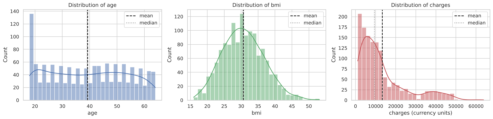
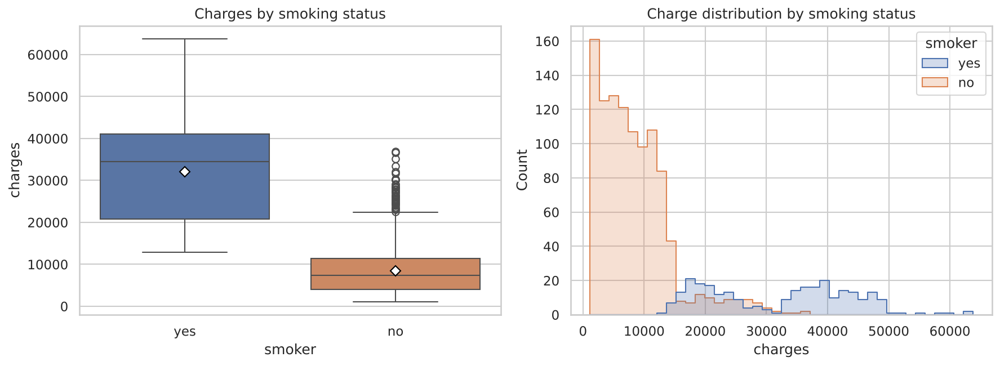
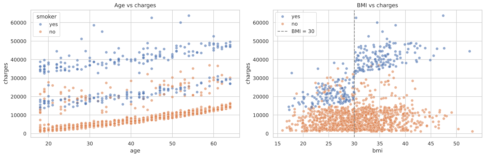
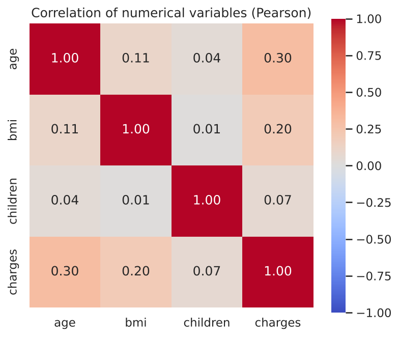
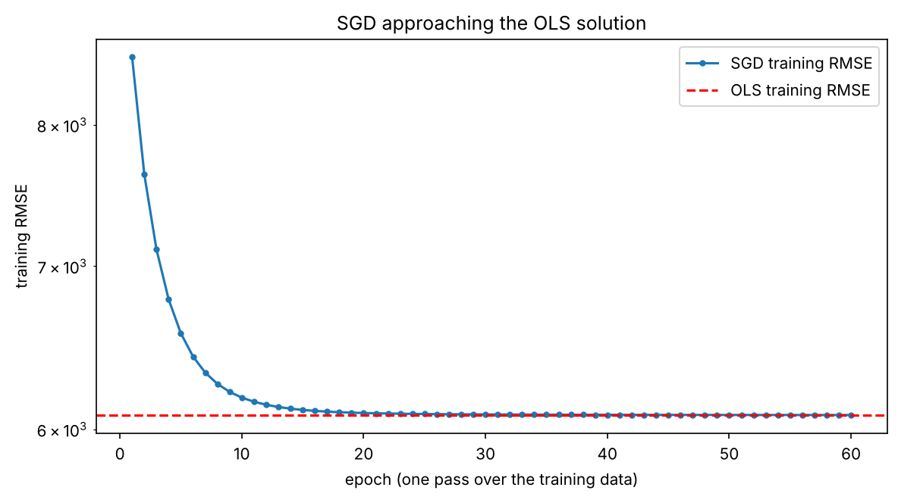
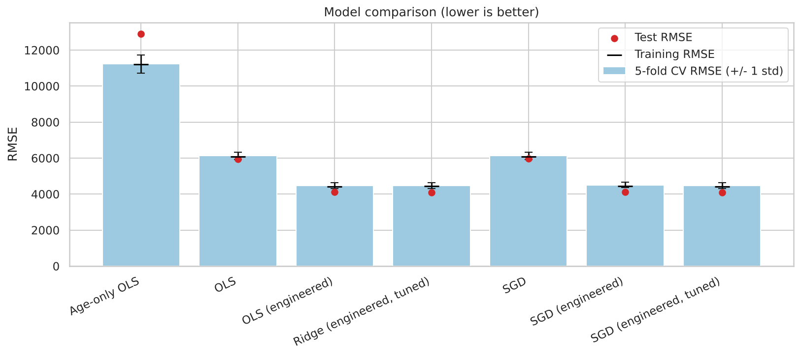
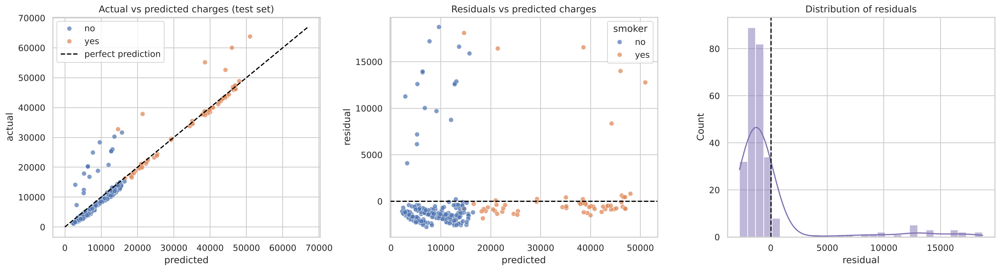
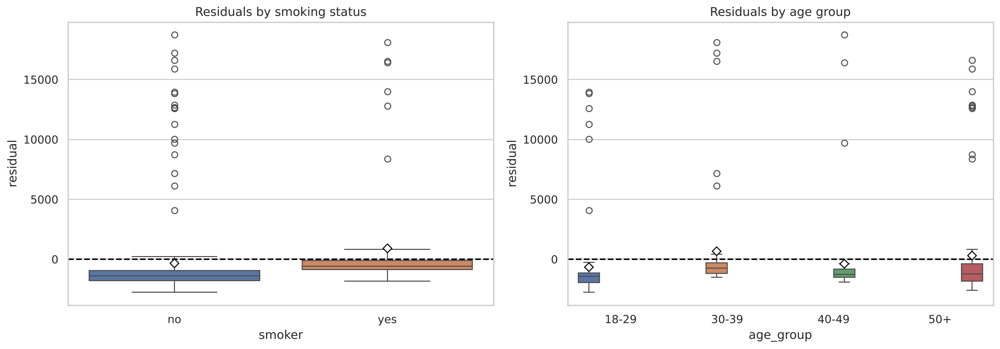

# Medical Insurance Cost Prediction Using Linear Regression

An end-to-end, beginner-to-intermediate machine learning project that predicts individual medical insurance charges with **Linear Regression**, solved two ways: **Ordinary Least Squares (OLS)** and **Stochastic Gradient Descent (SGD)**. It covers data inspection, cleaning, EDA, feature engineering, leakage-safe pipelines, cross-validation, residual analysis, a saved model and a validated prediction function.

> **Disclaimer:** this is a learning project built on a small public dataset. Its predictions are estimates, **not insurance quotes, guaranteed prices or medical advice**, and the model is not production-ready (see [Limitations](#limitations)).

## Table of contents
1. [Problem statement](#problem-statement) · 2. [Objectives](#objectives) · 3. [Dataset](#dataset) · 4. [Technologies](#technologies) · 5. [Repository structure](#repository-structure) · 6. [Workflow](#workflow) · 7. [EDA findings](#eda-findings) · 8. [Feature engineering](#feature-engineering) · 9. [OLS and SGD](#ols-and-sgd-methodology) · 10. [Metrics](#evaluation-metrics) · 11. [Results](#results) · 12. [Key findings](#key-findings) · 13. [Visualizations](#visualizations) · 14. [Installation](#installation) · 15. [Notebooks](#how-to-run-the-notebooks) · 16. [Predictions](#how-to-generate-predictions) · 17. [Tests](#running-the-tests) · 18. [Limitations](#limitations) · 19. [Future work](#future-improvements) · 20. [Git & GitHub](#git-and-github-commands)

## Problem statement
Given a person's `age`, `sex`, `bmi`, `children`, `smoker` status and `region`, estimate their annual medical insurance `charges` (a continuous number). This is a **supervised regression** problem.

## Objectives
- Load, inspect and clean the data without assuming it is clean.
- Explore the data and visualise distributions and relationships.
- Engineer features and **test** whether each one helps, instead of assuming.
- Train OLS and SGD linear regression on the *same* train/test split.
- Evaluate with RMSE, MAE and R², and compare using cross-validation.
- Analyse residuals, save the model with `joblib`, and expose a validated `predict_charges()` function.
- Organise, test and document the project for GitHub.

## Dataset
*Medical Cost Personal Dataset* - source: <https://raw.githubusercontent.com/stedy/Machine-Learning-with-R-datasets/master/insurance.csv>. 1,338 rows x 7 columns; stored in `data/raw/insurance.csv`.

| Column | Meaning | Type |
|---|---|---|
| `age` | age of the person (18-64) | numerical |
| `sex` | female / male | categorical (nominal) |
| `bmi` | body mass index (15.96-53.13) | numerical |
| `children` | number of dependants covered (0-5) | numerical (count) |
| `smoker` | yes / no | categorical (binary) |
| `region` | northeast / northwest / southeast / southwest | categorical (nominal) |
| `charges` | medical insurance charges - **the target** | numerical |

Checks found no missing values and no impossible values, and exactly **one duplicated row**, which was removed (1,337 rows remain; reasoning in notebook 02).

## Technologies
Python 3 · pandas · NumPy · Matplotlib · Seaborn · scikit-learn · joblib · Jupyter Notebook · pytest · Git/GitHub

## Repository structure
```
medical-insurance-cost-prediction/
├── data/
│   ├── raw/insurance.csv          # original data, never edited
│   └── processed/                 # cleaned data written by notebook 02 (git-ignored)
├── notebooks/                     # the project, in reading order
│   ├── 01_data_collection_and_understanding.ipynb
│   ├── 02_data_cleaning_and_eda.ipynb
│   ├── 03_feature_engineering.ipynb
│   ├── 04_ols_linear_regression.ipynb
│   ├── 05_sgd_linear_regression.ipynb
│   ├── 06_model_evaluation_and_comparison.ipynb
│   └── 07_final_model_and_predictions.ipynb
├── src/                           # reusable code shared by notebooks, scripts and tests
│   ├── data_preprocessing.py      # constants, load/clean, 80/20 split, input validation
│   ├── feature_engineering.py     # engineered features + the preprocessing Pipeline
│   ├── train.py                   # model builders, tuning, experiments, model selection, saving
│   ├── evaluate.py                # RMSE / MAE / R² helpers
│   └── predict.py                 # predict_charges() for new people
├── models/                        # saved pipeline (medical_insurance_model.joblib)
├── reports/
│   ├── figures/                   # PNG charts used in this README
│   └── model_comparison.csv       # CV / training / testing metrics for every model
├── tests/test_preprocessing.py    # pytest tests
├── requirements.txt               # dependencies
├── .gitignore                     # files Git must not track
└── README.md                      # this file
```
The notebooks *import* from `src/` rather than copy-pasting code, so notebooks, scripts and tests can never disagree.

## Workflow
1. **Load & clean** - `src/data_preprocessing.py`: read the CSV, drop the duplicate row. Extreme charges/BMI are **kept** (they are legitimate; 136 of the 139 IQR-flagged high charges are smokers).
2. **Split first** - `train_test_split(test_size=0.2, random_state=42)` -> 1,069 training rows, 268 test rows. Every model uses these same rows.
3. **Pipeline** - feature creation, encoding and scaling live *inside* a scikit-learn `Pipeline`, so they are fitted on training data only (during cross-validation, only on each training fold). No test-set information leaks.
4. **Model & evaluate** - cross-validation (5-fold, training data only) for choices; the test set is used for the final report only.

## EDA findings
(Full discussion in notebook 02.)
- **Charges are strongly right-skewed** (skewness 1.52; mean about 13,279 vs median about 9,386). `log(charges)` is nearly symmetric (-0.09).
- **Smokers cost far more**: mean about 32,050 vs about 8,441 for non-smokers (about 3.8x), with little overlap. Smoking status is the most important feature.
- **Age vs charges** looks roughly linear *within* groups, forming three upward bands (non-smokers; smokers; a higher smoker band).
- **BMI matters mainly for smokers**: correlation with charges is 0.81 among smokers but 0.08 among non-smokers; smokers' charges jump above BMI 30. That is an *interaction*.
- Sex, region and number of children show weak or confounded effects (e.g. the sex gap in mean charges mostly reflects more male smokers; medians are almost identical).
- These are associations in an observational sample; **correlation does not prove causation**.

## Feature engineering
- **Preprocessing** makes data usable (encoding, scaling); **feature engineering** creates new informative columns.
- **Encoding:** `sex` and `smoker` -> one 0/1 column each; `region` -> one-hot (3 columns, northeast is the reference); `age`, `bmi`, `children` stay numeric (testing children as one-hot gave no gain).
- **Engineered candidates** (rule-based, no leakage): `bmi_category`, `age_group`, `smoker_bmi`, `smoker_age`, `smoker_obese` (smoker AND BMI >= 30).
- **Tested by ablation with 5-fold CV** (baseline CV RMSE about 6,124): `smoker_obese` alone about 4,575 and `smoker_bmi` about 4,943 gave the big gains; `smoker_age` did **not** help (about 6,149); all five together about 4,480.

## OLS and SGD methodology
| | OLS | SGD |
|---|---|---|
| Class | `LinearRegression` | `SGDRegressor(max_iter=1000, tol=1e-3, random_state=42)` |
| How weights are found | closed-form least squares | iterative, one sample at a time |
| Scaling | not needed (coefficients stay in readable units) | `StandardScaler` on numeric features (essential) |
| Tuning | none | learning-rate schedule, `eta0`, `alpha` via grid search CV |

Evidence from notebook 05: **without scaling SGD diverged** (test RMSE about 8.6 x 10⁸); with scaling it matched OLS within about 14 RMSE points. Too few epochs and a tiny learning rate triggered `ConvergenceWarning`s and poor scores; an over-strong penalty (`alpha=100`) gave a terrible fit *without* any warning - so metrics must always be checked, not just warnings.

## Evaluation metrics
- **RMSE** - error in the units of `charges`; penalises large errors more.
- **MAE** - average absolute error.
- **R²** - improvement over always predicting the mean; can be negative.

## Results
Same split for every row. "Testing" figures come from the 268 held-out people.

### Required comparison (6 original features)
| Model | Dataset | RMSE | MAE | R² |
|---|---|---:|---:|---:|
| OLS | Training | 6,081.11 | 4,181.90 | 0.7299 |
| OLS | Testing | 5,956.34 | 4,177.05 | 0.8069 |
| SGD | Training | 6,082.18 | 4,164.15 | 0.7298 |
| SGD | Testing | 5,969.72 | 4,162.72 | 0.8061 |

### All experiments (test set; CV RMSE from training data)
| Model | CV RMSE | Test RMSE | Test MAE | Test R² |
|---|---:|---:|---:|---:|
| Age-only OLS | 11,223.76 | 12,894.78 | 9,657.79 | 0.0951 |
| OLS | 6,123.65 | 5,956.34 | 4,177.05 | 0.8069 |
| SGD | 6,124.44 | 5,969.72 | 4,162.72 | 0.8061 |
| **OLS (engineered)** - selected | 4,480.18 | 4,103.71 | 2,265.53 | 0.9084 |
| SGD (engineered) | 4,502.85 | 4,123.29 | 2,273.82 | 0.9075 |
| Ridge (engineered, tuned) | 4,477.49 | 4,095.11 | 2,267.79 | 0.9087 |
| SGD (engineered, tuned) | 4,476.67 | 4,100.79 | 2,267.55 | 0.9085 |

The full table (CV, training and testing rows) is in [`reports/model_comparison.csv`](reports/model_comparison.csv). Predicting the training mean for everyone gives a test R² of -0.008 (RMSE 13,612).

**Model selection rule (decided before looking at test results, training data only):** among models within one standard error of the best CV RMSE, pick the simplest. Four engineered models tie, so **OLS with engineered features** was selected.

## Key findings
1. **Features matter far more than the optimiser.** OLS and SGD are practically identical for a given feature set (test RMSE within about 15-20 points); adding smoker-based interactions cut test RMSE from 5,956 to 4,104 (-31%) and MAE from 4,177 to 2,266.
2. **Ridge and SGD tuning gave no meaningful gain** (CV differences of a few RMSE points vs a fold-to-fold standard deviation of about 145-165). With about 1,070 rows and few features, variance is not the problem. Degree-2 polynomial terms did not beat the targeted interactions.
3. **No overfitting** is visible: training, CV and test errors are close. Early models were *underfitting* (too simple for the smoker x BMI structure).
4. **Smokers have a different BMI relationship**: separate models show a BMI slope of about 8 per point for non-smokers vs about 1,492 for smokers; the age slope is nearly the same (about 263 vs 258). A separate-models approach improved the plain pooled model (test RMSE 5,956 -> 4,635) but not the engineered pooled model, so it was not adopted.
5. **Residuals:** about 9% of test people (23 of 268, mostly non-smokers) are under-predicted by more than 4,000 and cause about 89% of the squared error; everyone else is predicted to within about 1,300 on average. Their charges are not explained by the available features.

## Visualizations
Generated by the notebooks into `reports/figures/`.

| | |
|---|---|
|  |  |
|  |  |
|  |  |
|  |  |

**Adding your own screenshots:** save an image into `reports/figures/` (for example with `plt.savefig("reports/figures/my_plot.png", dpi=150, bbox_inches="tight")`), then reference it in this README with `` and commit the PNG.

## Installation
Requires **Python 3.10 or newer**.

```bash
git clone https://github.com/<your-username>/medical-insurance-cost-prediction.git
cd medical-insurance-cost-prediction
```

### Windows (PowerShell or Command Prompt)
```powershell
python -m venv venv
venv\Scripts\activate            # PowerShell and cmd. Your prompt now starts with (venv)
python -m pip install --upgrade pip
pip install -r requirements.txt
python -m ipykernel install --user --name medical-insurance --display-name "Python (medical-insurance)"
```
If PowerShell refuses to activate with an "execution policy" error, run once:
`Set-ExecutionPolicy -Scope CurrentUser RemoteSigned`, then activate again.

### macOS / Linux
```bash
python3 -m venv venv
source venv/bin/activate
pip install -r requirements.txt
```

## How to run the notebooks
1. Open the **project folder** in VS Code (*File > Open Folder*) so the working directory is correct. Install the *Python* and *Jupyter* extensions.
2. Open a notebook from `notebooks/`, click **Select Kernel** (top right) and choose the `venv` / "Python (medical-insurance)" kernel.
3. Run notebooks **in order, 01 to 07** (*Run All*). Notebook 02 writes the cleaned data and figures; notebook 06 writes `reports/model_comparison.csv`; notebook 07 saves the model.

Or from a terminal: `jupyter notebook` and open the files in `notebooks/`.

Train everything without notebooks (also regenerates `reports/model_comparison.csv` and the saved model, takes about 10 seconds):
```bash
python -m src.train
```

## How to generate predictions
From the project root:
```bash
python -m src.predict          # prints three example predictions
```
From your own Python script (run from the project root):
```python
from src.predict import predict_charges

estimate = predict_charges(age=35, sex="male", bmi=27.5, children=2,
                           smoker="no", region="northwest")
print(f"Estimated charges: {estimate:,.2f}")
```
For many people at once pass a DataFrame with the columns `age, sex, bmi, children, smoker, region` to `predict_dataframe()`. Invalid input (missing columns, unknown categories, impossible numbers) raises a clear `ValueError`; values outside the training range (age 18-64, BMI 15-54, 0-5 children) produce a warning because the model would be extrapolating.

Example outputs from the saved model (illustrative):
| Person | Estimate |
|---|---:|
| 25, female, BMI 22.0, no children, non-smoker, southwest | 4,393.70 |
| 45, male, BMI 31.5, 2 children, smoker, southeast | 40,536.83 |
| 60, female, BMI 27.0, 1 child, non-smoker, northeast | 14,977.15 |

## Running the tests
```bash
python -m pytest -v
```
23 tests check: clean-data properties, a reproducible 80/20 split, input validation (missing columns, missing values, invalid categories and numbers), engineered-feature values, that the preprocessor is fitted on training data only, finite predictions, and that the saved model loads and predicts. (One test is skipped if the model file does not exist yet - run `python -m src.train` first.)

## Limitations
- Small public dataset (1,337 people) with undocumented origin, time period and currency.
- Only ages 18-64 and BMI about 16-53 observed; predictions outside are extrapolations.
- A linear model with hand-built interactions: about 9% of cases are badly under-predicted, because the data lacks information (e.g. medical history) that would explain them.
- No fairness analysis; using `sex` or `region` for real pricing could be inappropriate or illegal. Sex and region add almost nothing here.
- Charges are right-skewed; modelling `log(charges)` was not tried.
- The saved `.joblib` file depends on `src/` and on the scikit-learn version; load only trusted files. There is no monitoring, versioning or retraining plan, so **saving a model does not make it production-ready**.

## Future improvements
- Try `log(charges)` as the target, or tree-based models (e.g. gradient boosting) for comparison.
- Add a hold-out period or external dataset to check generalisation.
- Add fairness analysis and uncertainty/prediction intervals.
- **SQL:** in a larger version, data would live in a database. SQL would extract, filter, join and aggregate it (e.g. `SELECT ... FROM insurance WHERE age BETWEEN 18 AND 64`) and `pd.read_sql` would feed the same pipeline; nothing downstream would change.
- Wrap `predict_charges` in a small web app or API, with model versioning.

## Git and GitHub commands
Run from inside the project folder.

```bash
# 1. Initialise Git
git init
git branch -M main

# 2. .gitignore already exists (it excludes venv, caches, temp files, secrets, generated CSVs)

# 3. Add the project files
git add .
git status                      # check no venv/, __pycache__ or secrets are listed

# 4. Commit
git commit -m "Medical insurance cost prediction: OLS and SGD linear regression"

# 5. Create an EMPTY repository on github.com (no README/licence), then connect it
git remote add origin https://github.com/<your-username>/medical-insurance-cost-prediction.git

# 6. Push
git push -u origin main
```
If Git asks who you are: `git config --global user.name "Your Name"` and `git config --global user.email "you@example.com"`. GitHub no longer accepts account passwords for pushes - sign in through the browser prompt (Git Credential Manager on Windows) or use a personal access token.

Notes on what is and is not committed: the virtual environment, `__pycache__`, `.pytest_cache`, notebook checkpoints, `.env`/key files and the regenerated `data/processed/*.csv` are excluded. The raw dataset is committed once (`data/raw/insurance.csv`, about 55 KB) because the project reads it; no second copy is stored. The saved model is about 6 KB, so it is committed to let others predict right after cloning.

## Acknowledgements
Dataset: *Medical Cost Personal Dataset* (Brett Lantz, *Machine Learning with R*), as hosted in the `stedy/Machine-Learning-with-R-datasets` repository.
